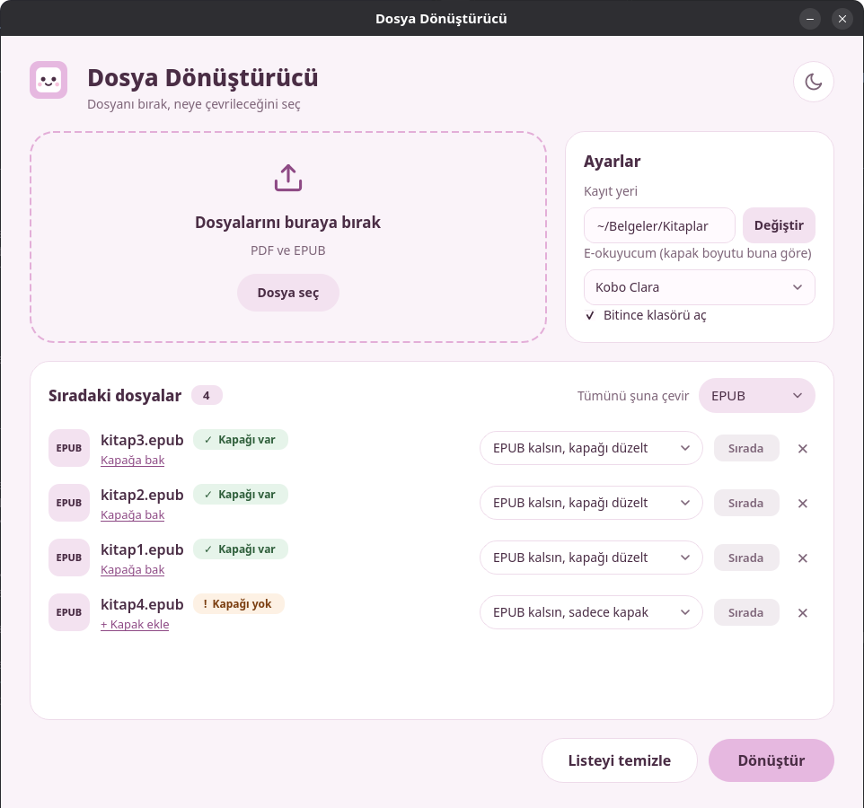
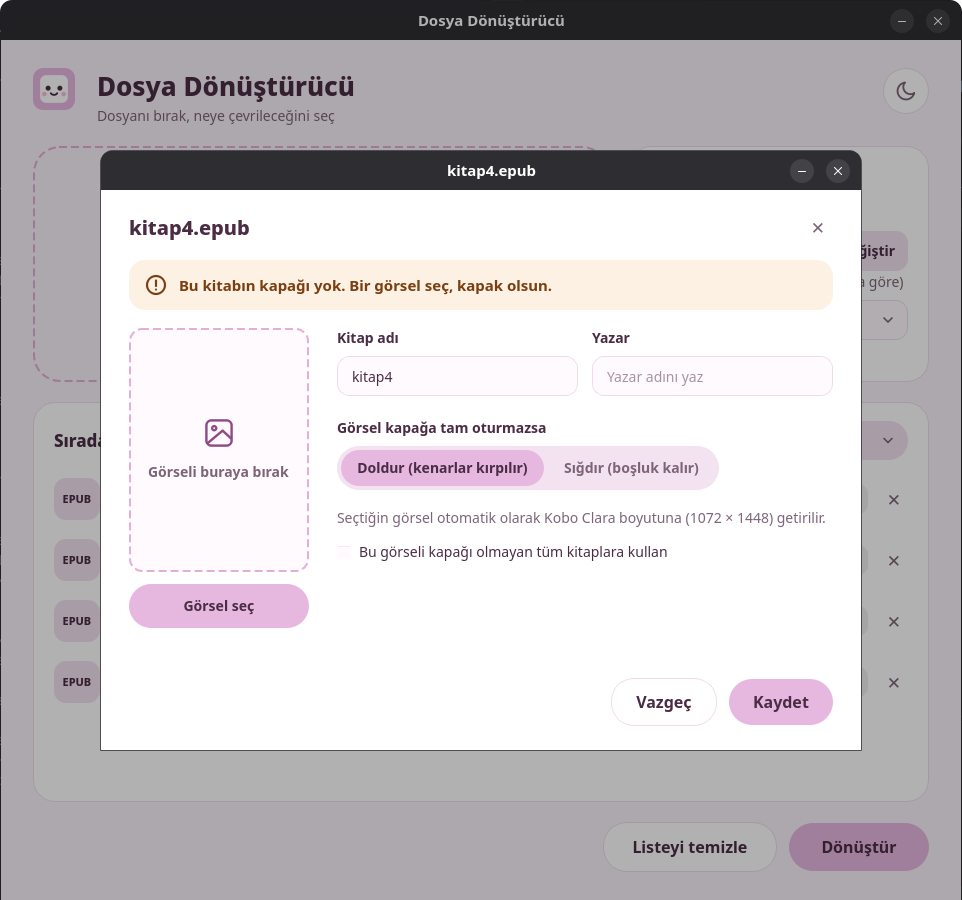
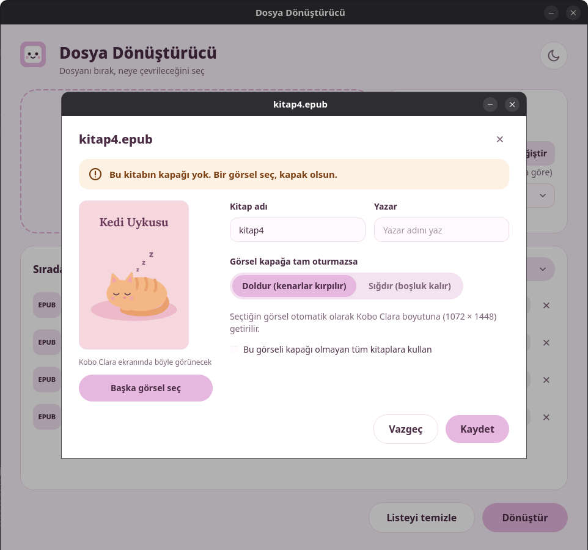
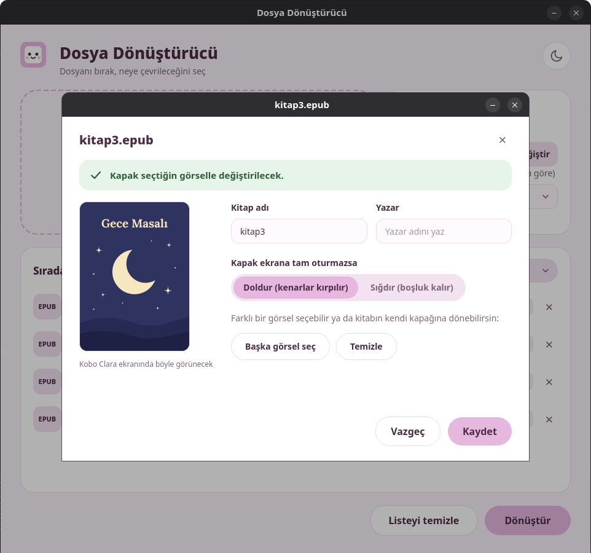

# Dosya Dönüştürücü

[English](README.md) | **Türkçe**

E-kitaplar için masaüstü dosya dönüştürücü. EPUB ve PDF dosyalarını birbirine çevirir, EPUB kitaplara e-okuyucunuzun ekranına uygun kapak ekler ya da mevcut kapağı düzeltir. PySide6 (Qt) ile yazılmıştır.

> ⚠️ **Geliştirme aşamasında.** Temel özellikler çalışıyor, eksik kısımlar güncellemelerle eklenecek. Arayüz şimdilik yalnızca Türkçe.

## Görünüm



| Kapak yok | Görsel seçildi | Kapak var |
|---|---|---|
|  |  |  |

## Özellikler

- **EPUB kapak ekleme / düzeltme** — kapak, seçilen e-okuyucunun çözünürlüğüne getirilir (Kobo Clara, Kobo Libra, Kindle, Kindle Paperwhite, PocketBook). *Doldur* ve *Sığdır* seçenekleriyle önizleme.
- **Kitap adı ve yazar düzeltme** — kapak penceresinden.
- **EPUB → PDF**
- **PDF → EPUB** — kayıplıdır: yalnızca yazılar aktarılır, resimler ve sayfa düzeni kaybolur. Uygulama bunu "Kayıplı" etiketiyle gösterir.
- **Sürükle-bırak** ile dosya ekleme.
- **Orijinal dosyaya dokunmaz** — çıktı her zaman seçilen kayıt klasörüne yeni dosya olarak yazılır (varsayılan: `Belgeler/Kitaplar`). Aynı adlı dosya varsa `ad (2).epub` gibi yeni ad verilir.

## Kurulum

Python 3.10 veya üstü gerekir. openSUSE Tumbleweed'de (Linux) denendi. Başka sistemlerde de çalışabilir ama henüz denenmedi.

Bazı Linux dağıtımlarında komut `python` yerine `python3`'tür.

```bash
git clone https://github.com/mimiumm/dosya-donusturucu.git
cd dosya-donusturucu
python -m venv .venv
source .venv/bin/activate        # Windows: .venv\Scripts\activate
pip install -r requirements.txt
```

## Kullanım

Arayüzü açmak için:

```bash
python gui_qt.py
```

Komut satırından tek dosya dönüştürmek için:

```bash
python main.py kitap.epub kitap.pdf
```

## Yol haritası

- [ ] MOBI, AZW3 ve DOCX desteği
- [ ] "Tümünü şuna çevir" (toplu hedef seçimi) — düğmesi görünüyor, henüz çalışmıyor
- [ ] İngilizce arayüz
- [ ] Koyu tema — düğmesi görünüyor, henüz çalışmıyor
- [ ] CBZ ve diğer formatlar
- [ ] Hazır paketler (PyInstaller)

## Lisans

[AGPL-3.0](LICENSE)

© 2026 mimiumm
